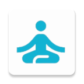
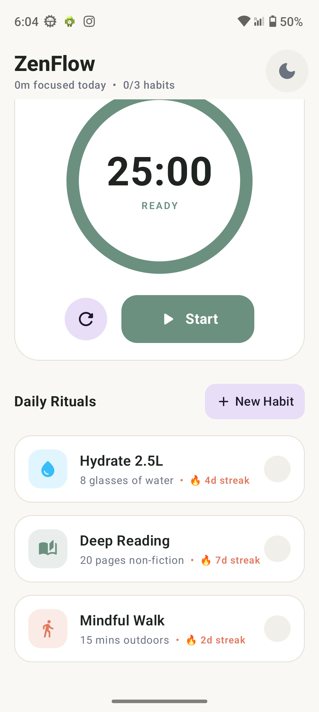
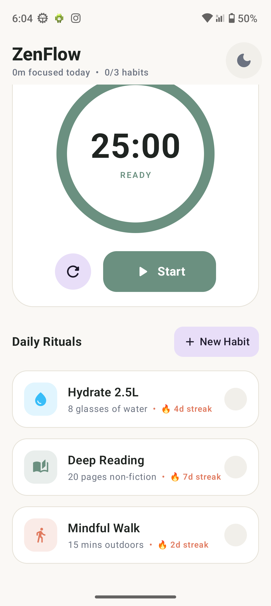
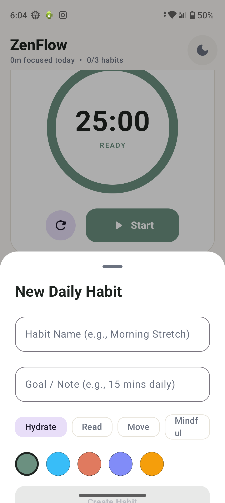
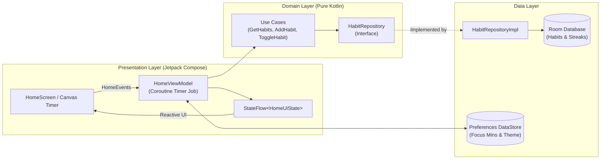

<div align="center">



# ZenFlow
### Aesthetic Pomodoro Focus Timer & Daily Micro-Habit Tracker

*Stay present. Build daily rituals. Track your focus effortlessly.*

[](https://kotlinlang.org)
[](https://developer.android.com/jetpack/compose)
[](https://developer.android.com)
[](https://kotlinlang.org)
[](https://developer.android.com)

<br/>

[📥 Download Latest APK (Debug)](apk/ZenFlow-Debug.apk) • [🐛 Report Bug](https://github.com/RaviYadavO4/ZenFlow/issues) • [✨ Request Feature](https://github.com/RaviYadavO4/ZenFlow/issues)

</div>

---

## 🎯 Overview

**ZenFlow** is a minimalist, offline-first productivity application built with **100% Kotlin** and **Jetpack Compose**. Crafted with a **Warm Nordic Pastel & Deep Charcoal** design system, it combines a reactive Pomodoro countdown engine with a streak-driven daily habit tracker.

> **Engineering Focus:** Built to showcase advanced **Jetpack Compose Canvas animations**, **Coroutine Job lifecycle management**, **Unidirectional Data Flow (UDF)**, and **Clean Architecture** in a sleek, production-quality Android package.

---

## 📱 Visual Showcase

<div align="center">

| ☀️ Warm Alabaster Light Mode | 🌑 Calm Charcoal Dark Mode | ➕ Create Daily Ritual |
| :---: | :---: | :---: |
|  |  |  |
| *Default Nordic light theme with live Canvas timer* | *Persistent dark theme powered by DataStore* | *Custom habit creation with icons & pastel colors* |

</div>

---

## ✨ Key Features

| Feature | Technical & UX Implementation |
| :--- | :--- |
| **⏱ Custom Canvas Pomodoro Ring** | Smooth animated progress arc drawn with Jetpack Compose `Canvas` (`animateFloatAsState` & `animateColorAsState`). |
| **🎛 Multi-Mode Focus Engine** | Instant switching between **Deep Focus (25m)**, **Short Break (5m)**, and **Long Break (15m)** with Start, Pause, and Reset controls. |
| **📈 Live Focus Telemetry** | Automatically logs completed 25-minute focus sessions into **Preferences DataStore** and updates today's focus counter in real time. |
| **🔥 Streak-Driven Habit Tracker** | Interactive daily habit cards with animated check states, strikethrough transitions, and automatic streak counters persisted in **Room**. |
| **🌱 Smart Starter Habits** | Automatically seeds curated sample rituals (*Hydrate 2.5L, Deep Reading, Mindful Walk*) on first launch for an immediate out-of-the-box experience. |
| **🌓 Persistent Theme Engine** | Zero-flicker Light/Dark theme switching backed by **Jetpack Preferences DataStore**. |

---

## 🏗 Architecture & Data Flow

ZenFlow follows **Clean Architecture** and **Unidirectional Data Flow (UDF)**, keeping the UI completely stateless and business rules isolated inside pure Kotlin Use Cases.



---

## 🛠 Tech Stack

- **Language:** Kotlin
- **UI Toolkit:** Jetpack Compose, Material Design 3, Custom Canvas Drawing, Compose Animations
- **Architecture:** MVVM + Clean Architecture (Presentation, Domain, Data layers)
- **Concurrency:** Kotlin Coroutines (`Job`, `delay`), `StateFlow`, `combine`
- **Dependency Injection:** Dagger Hilt (`@HiltViewModel`)
- **Local Persistence:** Room Database, Jetpack Preferences DataStore

---

## 📂 Package Structure

```text
com.portfolio.zenflow
├── 📂 data
│   ├── 📂 local          # Room Entity, DAO, Database & DataStore FocusPreferences
│   └── 📂 repository     # HabitRepositoryImpl & Entity <-> Domain Mappers
├── 📂 di                 # Dagger Hilt Dependency Injection Modules
├── 📂 domain
│   ├── 📂 model          # FocusMode Enum & Habit Domain Model
│   ├── 📂 repository     # HabitRepository Contract
│   └── 📂 usecase        # GetHabits, AddHabit, ToggleHabit & DeleteHabit Use Cases
└── 📂 presentation
    ├── 📂 components     # CircularTimerSection, HabitItemCard & AddHabitSheet
    ├── 📂 home           # HomeScreen, HomeViewModel & HomeUiState
    └── 📂 theme          # Warm Alabaster & Calm Charcoal Color Palettes
```

---

<details>
<summary><b>⚙️ Click to expand: Build & Local Setup Instructions</b></summary>

<br/>

1. **Clone the repository**
   ```bash
   git clone https://github.com/RaviYadavO4/ZenFlow.git
   cd ZenFlow
   ```
2. **Open in Android Studio**
   - Open **Android Studio (Ladybug 2024.2+ recommended)**.
   - Click **File → Open** and select the cloned `ZenFlow` folder.
3. **Sync & Run**
   - Let Gradle download dependencies automatically.
   - Run on an Android Emulator or physical device running **Android 7.0 (API 24)** or higher.

</details>

---

## 🗺 Future Roadmap

- [ ] **Ambient Soundscapes:** Built-in rain, white noise, and lo-fi audio player during focus sessions.
- [ ] **Completion Chime & Haptics:** Subtle vibration and audio alert when a timer reaches `00:00`.
- [ ] **Weekly Focus Heatmap:** 7-day consistency chart visualizing daily focus minutes and habit completion rates.
- [ ] **Automated Tests:** Unit tests for `HomeViewModel` timer coroutines and `ToggleHabitUseCase` streak logic.

---

<div align="center">

### 👨‍💻 Developed by **Ravi Yadav**

[](https://github.com/RaviYadavO4)

*If you found this project useful or inspiring, feel free to give it a ⭐!*

</div>
